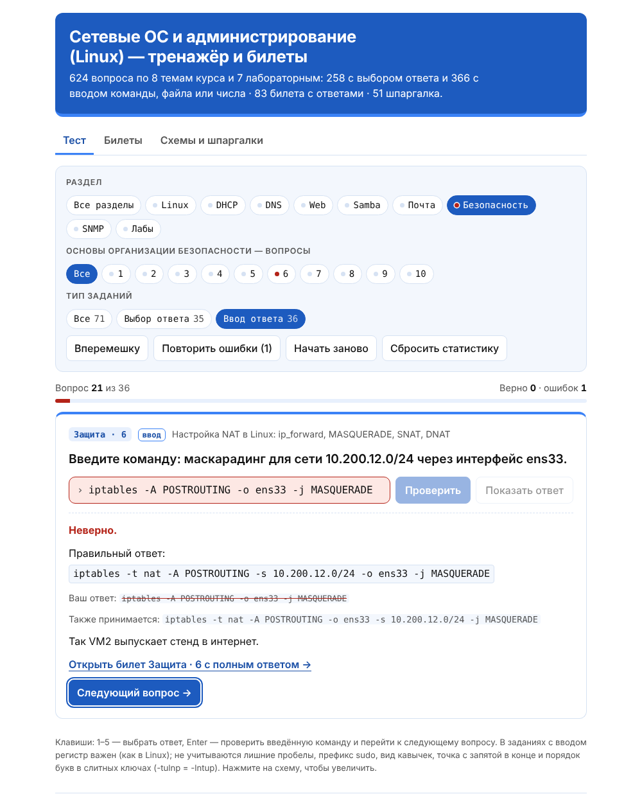

# Сетевые ОС (Linux): тренажёр и билеты

Тренажёр к защите лаб и экзамену по «Сетевым ОС и администрированию сетей, часть 1 — Linux» (Казаков Ф.А.). Около 620 вопросов по восьми темам лекций и семи лабам. Больше половины — с вводом ответа: команда, путь к файлу, строка конфига, порт или расчёт подсети. Ещё есть билеты с ответами, шпаргалки и схемы учебного стенда.

Сайт: https://ktoblyachtoblyayablya.github.io/netos-trainer/



В примерах стенд — `10.200.12.0/24`, зона — `ki0000.ru`. На своём стенде подставьте свои.

## Что внутри

- Тест по разделам: Linux, DHCP, DNS, Web, Samba, почта, безопасность, SNMP, лабы 0–6. После ответа показываются пояснение, схема и шпаргалка.
- Задания с вводом. Регистр важен, как в Linux, кроме DNS-записей, директив Apache и параметров Samba. Лишние пробелы, `$`/`#`, `sudo`, вид кавычек и порядок букв в слитных ключах не важны: `ss -tulnp` = `ss -lntup`. Если у команды несколько записей, принимаются все.
- Билеты: ответ на каждую тему и порядок выполнения каждой лабы с вопросами защиты.
- Все билеты одной страницей (`#all`) и версия для печати (`#print`).
- Повтор ошибок, светлая и тёмная тема. Прогресс хранится в браузере, сервер не нужен.

## Запуск

Открыть `index.html` в браузере или поднять сервер: `python3 -m http.server 8000`.

## Как добавить вопрос

Вопросы лежат в `data/questions/*.js`, билеты — в `data/answers/*.js`, шпаргалки — в `data/cards.js`. Пример задания с вводом:

```js
{t:"sec-6", q:"Введите команду: маскарадинг для сети 10.200.12.0/24 через интерфейс ens33.",
 a:["iptables -t nat -A POSTROUTING -s 10.200.12.0/24 -o ens33 -j MASQUERADE",
    "iptables -t nat -A POSTROUTING -o ens33 -s 10.200.12.0/24 -j MASQUERADE"],
 h:"команда целиком",
 e:"Так VM2 выпускает стенд в интернет."}
```

`t` — тема, `q` — вопрос, `a` — принимаемые ответы (первый показывается как эталон), `e` — пояснение. В вопросах с выбором вместо `a` пишется `o` — варианты, первый правильный. Необязательные поля: `h` — подсказка в поле ввода, `ci: 1` — без учёта регистра, `f` — картинка, `fb: 1` — показать картинку сразу, `c` — шпаргалка.

После правок запустите `node tools/validate.js` (нужен Node.js 18+). Он заодно проверяет, что варианты ответа не совпадают после нормализации. Та же проверка идёт в GitHub Actions при каждом пуше.

## Слайды

Слайды в `img/slides` взяты из лекций курса (Казаков Ф.А., СФУ). Права на них у авторов, под GPL они не попадают. Схемы стенда в `img/svg` нарисованы для проекта, исходник — `tools/draw_src/schemes.py`.

## Лицензия

Copyright (C) 2026 Пантелеев Г.Д. Код, вопросы, билеты и схемы `img/svg` распространяются под [GPL-3.0-or-later](LICENSE).
